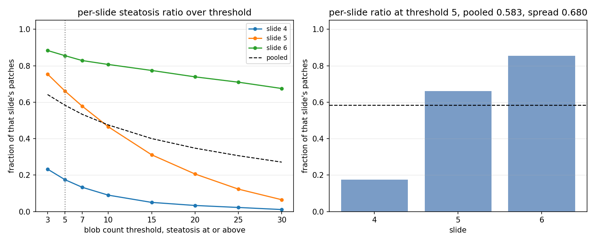
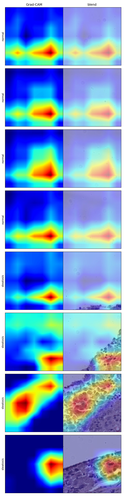

# Detection of Liver Steatosis from Microscopy Images

An end-to-end pipeline for the automated detection of **liver steatosis (hepatic steatosis)** from whole-slide histopathology (WSI) images.

> Istanbul Technical University - Faculty of Computer and Informatics
> Department of Computer Engineering - Graduation Project (June 2026)
>
> **Student:** İsmet Umuralp Şen
> **Advisor:** Prof. Dr. Behçet Uğur Töreyin

---

## Project Overview

Hepatic steatosis, defined as the excessive accumulation of lipid (fat) droplets within hepatocytes, is the primary histopathological feature of non-alcoholic fatty liver disease (NAFLD). In current clinical practice, steatosis grading is performed by pathologists examining H&E-stained biopsy slides under a microscope; this process is time-consuming and subject to inter-observer variability.

This project presents an automated classification system that processes raw whole-slide images in SVS format and distinguishes steatotic from normal liver tissue **without any manual annotation**: every training label is the output of a morphological blob counter run at a fixed physical scale. That makes the labels reproducible, and it also bounds what they can mean — the model is measured against the counter, not against a pathologist's grade (see [Limitations](#limitations)).

The system is designed to run entirely on CPU hardware.

## Pipeline

The pipeline is a chain of `bin/` entry points. Each one reads its parameters from `configs/default.yaml` and its input from the artifact the previous stage wrote, so a run is a sequence of commands with a single configuration behind them.

| Order | Entry point | What it does |
|-------|-------------|--------------|
| 1 | `bin/extract_patches.py` | Tiles each specimen into 256 x 256 patches at a fixed 0.5 µm/px — a 128 µm field of view whatever the scanner's native magnification — and drops a background tile when its mean grayscale is at or above the single global cutoff `extraction.tissue_gray_max` (235). Writes the patch tree, `patches.csv` and `results/extraction_summary.json`. |
| 2 | `bin/label_patches.py` | Labels every patch by counting morphological blobs in square microns at the patch's own achieved resolution; at least `labeling.blob_threshold` (5) blobs is steatosis. Writes the class tree and `labels.csv`. |
| 3 | `bin/ablate_threshold.py` | Sweeps `ablation.thresholds` over the same index and reports the class distribution **per specimen** at every threshold. Writes `results/label_analysis/`. |
| 4 | `bin/train.py` | Trains leave-one-specimen-out over the cohort the manifest admits, selecting each fold's epoch on validation F1. Writes `results/fold_summary.csv`, `results/training_summary.json`, a log and a checkpoint per fold. |
| 5 | `bin/evaluate.py` | Scores a checkpoint over the specimens it never trained on, with bootstrap intervals. Writes `results/evaluation/`. |

Two further entry points run after training: `bin/predict.py` (inference over an image or a directory, writing `results/predictions.csv`) and `bin/gradcam.py` (Grad-CAM figures for one specimen, writing `results/gradcam/`).

### Reproduction

GNU Make is a prerequisite: it is not bundled and must be on `PATH` (on Windows the install used here is MSYS2's, at `C:\msys64\usr\bin\make.exe`). Without it, run the stages directly — `RUN` in the Makefile is `PYTHONPATH=. python`, e.g. `set PYTHONPATH=. && python bin/extract_patches.py --help`.

`make all` runs the five stages in that order and is the single command that reproduces every number reported in this README. The Makefile reads its paths and the training cohort from `configs/default.yaml` and `data/manifest.yaml` through the project's own code; it names no directory and no specimen itself.

```bash
make all        # extract -> label -> ablate -> train -> evaluate
```

The individual stages are `make extract`, `make label`, `make ablate`, `make train`, `make evaluate`, plus `make predict`, `make gradcam`, `make install` and `make test`. `make clean` removes `results/` and the generated label directory and nothing else — the `.svs` slides are never touched, by the same path guard the extraction stage uses. Training runs on CPU.

## Folder Structure

```
.
├── Makefile                      # `make all` reproduces every reported number in one command
├── pyproject.toml                # package metadata, dependencies, pytest and ruff config
├── requirements.txt              # the same dependencies, for a non-editable install
├── configs/default.yaml          # the single source of runtime parameters
├── data/                         # the six .svs slides (git-ignored) and manifest.yaml (tracked)
├── blobcount/                    # the package
│   ├── __init__.py               # package marker, version
│   ├── config.py                 # load, validate, override, seed control, device selection
│   ├── registry.py               # load and validate the manifest, gate specimen usability
│   ├── slides.py                 # slide metadata, resolution planning, patch reading, adaptive tissue threshold
│   ├── blobs.py                  # blob counting in physical units, adaptive gray threshold, Reinhard stain normalization
│   ├── extract.py                # patch extraction orchestration, index CSV emission, path guards
│   ├── labeling.py               # patch-to-label assignment, output directory lifecycle
│   ├── ablation.py               # threshold sweep with per-specimen breakdown
│   ├── splits.py                 # leave-one-specimen-out fold construction
│   ├── data.py                   # dataset, transforms, per-fold class weights, sampler
│   ├── models.py                 # model construction from a name
│   ├── train.py                  # cross-validation training loop, epoch selection, summary
│   ├── evaluate.py               # metrics, integrity guard, bootstrap confidence intervals
│   └── interpret.py              # Grad-CAM
├── bin/                          # the CLI entry points, in run order
│   ├── extract_patches.py
│   ├── label_patches.py
│   ├── ablate_threshold.py
│   ├── train.py
│   ├── evaluate.py
│   ├── predict.py
│   └── gradcam.py
├── results/                      # generated artifacts: metrics, figures and summaries are tracked, *.pth are not
├── tests/                        # one test module per package module
│   ├── conftest.py               # shared fixtures: synthetic patch, temporary output tree
│   ├── test_config.py            # config tests
│   ├── test_registry.py          # registry tests
│   ├── test_slides.py            # resolution planning and metadata tests
│   ├── test_blobs.py             # blob counter and scale-invariance tests
│   ├── test_extract.py           # extraction tests
│   ├── test_labeling.py          # labeling tests
│   ├── test_ablation.py          # ablation tests
│   ├── test_splits.py            # LOSO tests
│   ├── test_data.py              # dataset and sampler tests
│   ├── test_models.py            # model construction tests
│   ├── test_train.py             # training summary tests
│   ├── test_evaluate.py          # metric and guard tests
│   └── test_interpret.py         # Grad-CAM tests
├── LICENSE
└── README.md
```

The extracted patches and the labelled tree are generated data and live outside the repository, at the `paths.patches` and `paths.labels` of `configs/default.yaml` (`%LOCALAPPDATA%\UmurOS\dataset` on this machine). A fresh clone that runs `make all` writes them there, not into the checkout.

## Installation

```bash
python -m venv .venv
# Windows
.venv\Scripts\activate
# Linux / macOS
source .venv/bin/activate

make install     # python -m pip install -e ".[dev]"
```

**OpenSlide note:** `bin/extract_patches.py` requires the OpenSlide binary library installed on the system to read SVS files. On Windows it can be installed with `pip install openslide-bin`, on Linux with `apt-get install openslide-tools`. (Only needed for the patch extraction stage.)

## Labels and the Threshold Ablation

Every label is the output of a morphological blob counter, not a pathologist's judgement. A patch is labelled steatosis when it holds at least `labeling.blob_threshold` (**5**) blobs, where a blob is a connected component whose area is between 3.1 and 125 µm² and whose circularity is at least 0.6, counted below a per-slide adaptive gray threshold. The counter works in physical units — square microns against each patch's own achieved µm/px — so the same structure is counted the same way at every slide's native magnification. The labeling rule and its threshold are configured values (`blobs.*`, `labeling.blob_threshold` in `configs/default.yaml`); they are not derived from the data.

The ablation sweep exists because a pooled class ratio hides exactly the thing that decides whether a threshold means anything: how differently the slides label. All numbers in this section are from `results/label_analysis/threshold_ablation.json`, which `make ablate` regenerates.

**Per-specimen class distribution at the selected threshold 5** (the three specimens the manifest clears for training; patches and steatosis counts are over the artifact's `blob_counts`):

| Specimen | Patches | Steatosis | Steatosis ratio | Gray threshold | Achieved µm/px |
|----------|---------|-----------|-----------------|---------------|----------------|
| 4 | 1835 | 321 | 0.175 | 233.3 | 0.5005 |
| 5 | 1976 | 1307 | 0.661 | 127.8 | 0.5001 |
| 6 | 2191 | 1874 | 0.855 | 126.8 | 0.4999 |

Pooled over the three specimens the ratio is **0.583** (3502 of 6002), with a per-specimen spread of **0.680**. No pooled ratio at any swept threshold makes the per-specimen spread close, and the balance the pooled number appears to show at threshold 10 (0.475) is an average over one slide labelling 9% steatotic and another labelling 81% — a spread of 0.717, wider than at the selected 5 — not a property of any slide.

**The spread is not separable from staining intensity, and the artifact says so in one number per slide.** The same file records `per_slide_gray_threshold`: the gray level above which a blob on that slide is not counted. It is **233.3** on specimen 4, **127.8** on 5 and **126.8** on 6 — and specimen 4's is within 1.7 of the 235 above which the extraction stage discards a whole tile. One per-slide number derived from staining intensity therefore drives the three ratios, the 0.680 spread and the count distributions behind them: at the selected threshold specimen 4's mean blob count is **2.63** with a **median of 0**, against means of 11.21 and 47.93 on the other two. A specimen whose windows sit near the filter's own ceiling has its blobs counted under a cutoff two slabs higher than the other two specimens get, so the per-specimen label spread and the per-slide staining intensity are one measurement here, not two that can be varied independently. This has been an open finding on this dataset since 2026-09-29 (E1d/E1e); the rebuilt pipeline reproduces the same numbers from its own artifact rather than inheriting them, which is a change of provenance and not of result. Spec §3.3 sanctions per-slide adaptive gray thresholds, so the rule is left as it is and characterised here.

**The sweep**, one row per threshold (`n_steatosis` counts patches at or above the threshold):

| Threshold | n_steatosis | n_normal | Pooled ratio | Per-specimen spread | Selected |
|-----------|-------------|----------|--------------|---------------------|----------|
| 3 | 3853 | 2149 | 0.642 | 0.651 | |
| 5 | 3502 | 2500 | 0.583 | 0.680 | yes |
| 7 | 3201 | 2801 | 0.533 | 0.695 | |
| 10 | 2852 | 3150 | 0.475 | 0.717 | |
| 15 | 2403 | 3599 | 0.400 | 0.724 | |
| 20 | 2087 | 3915 | 0.348 | 0.706 | |
| 25 | 1839 | 4163 | 0.306 | 0.687 | |
| 30 | 1627 | 4375 | 0.271 | 0.664 | |

The configured range does **not** bracket the measured count distribution: 3741 of the 6002 patches carry a blob count outside the swept range 3–30 (2149 below it, 1592 above it; the counts run min 0, p50 8.0, mean 21.99, max 150), so the sweep describes the knee of the distribution and not its tail. The artifact records this as `threshold_range_coverage.brackets_distribution: false`.

<p align="center">
  
</p>

## Results

**These numbers are a verification that the rebuilt pipeline runs end to end over the cohort the manifest admits; they are not a clinical cohort result.** Three specimens are cleared for training, which gives three leave-one-specimen-out folds, each training on two specimens and validating on the third. A three-fold mean over three specimens describes how this pipeline behaves on this dataset and nothing beyond it. Every figure below cites the committed artifact it was read from, and `make all` regenerates every number below — the Grad-CAM figure is the exception, drawn by `make gradcam`, which is not part of `all` (`Makefile:43`).

### Leave-one-specimen-out cross-validation

One row per fold at the epoch that fold selected on validation F1, from `results/fold_summary.csv`. The mean and the population standard deviation over the three selected epochs are from `results/training_summary.json`:

| Fold | Held-out specimen | Selected epoch | Accuracy | Precision | Recall | F1 |
|------|-------------------|----------------|----------|-----------|--------|----|
| 0 | 4 | 5 | 0.804 | 0.399 | 0.240 | 0.300 |
| 1 | 5 | 2 | 0.773 | 0.748 | 0.992 | 0.853 |
| 2 | 6 | 3 | 0.721 | 0.932 | 0.726 | 0.816 |
| | | **Mean ± std** | **0.766 ± 0.034** | **0.693 ± 0.221** | **0.653 ± 0.312** | **0.656 ± 0.253** |

The per-fold spread is the honest description of a three-specimen cohort. The fold that held out specimen 4 — the slide the labeling rule marks 17.5% steatotic, the lowest of the three — selected an epoch with an F1 of 0.300 (77 true positive, 116 false positive, 244 false negative, 1398 true negative); the folds that held out specimens 5 and 6 selected 0.853 and 0.816. Each fold stopped early past its selected epoch (after 8, 5 and 6 epochs respectively, against a configured maximum of 10), and no metric below is a final-epoch number.

**Every figure in this table is the best of up to ten attempts on the very specimens it is reported over, so it is an upper bound and not an estimate of performance on unseen tissue.** With three specimens there is no third split: the held-out specimen *is* the validation set, so the epoch that selected it is chosen by the maximum of the fold's own per-epoch F1s on those same patches. Averaging the epochs each fold ran rather than its best one gives per-fold F1s of **0.249 / 0.836 / 0.573** over the 8, 5 and 6 epochs in `results/training_log_fold0.csv`, `…fold1.csv` and `…fold2.csv` — a three-fold mean of **0.553** against the **0.656** selected-epoch headline. The gap is the optimism the headline carries and this table does not otherwise show. The per-fold epoch count, the epoch selected and both of those averages are in `results/training_summary.json` under `epoch_selection`, so the claim is checkable from an artifact and not only from this sentence; the logs carry the epochs themselves.

### Held-out evaluation of one fold

`bin/evaluate.py` scores the fold-0 checkpoint — fitted on specimens 5 and 6 — over the specimen that fold held out. **These are not a second result: they are the fold-0 row of the table above, re-derived by the evaluation stage from the same checkpoint over the same patches**, and they are not an independent estimate of anything. From `results/evaluation/medical_metrics.json`, over all 1835 patches of specimen 4:

| Metric | Value |
|--------|-------|
| Accuracy | 0.804 |
| Precision (PPV) | 0.399 |
| Recall (sensitivity) | 0.240 |
| Specificity | 0.923 |
| F1 | 0.300 |
| NPV | 0.851 |
| AUC (ROC) | 0.716 |

The bootstrap intervals this artifact carries are degenerate — every bound equals the point estimate — because the interval is drawn over **specimens**, at the configured 2000 resamples and 95% level, and this evaluation scores a single specimen. Resampling over specimens rather than patches is the correct unit: patches from one slide are not independent observations (spec §3.4). But a one-specimen resample cannot move, so every bound equals its point estimate and the interval carries no information about sampling variation. **This README states that; the artifact states it in its own `bootstrap` block as `"unit": "specimen"`, `"n_units": 1` and `"degenerate": true`.**

### Grad-CAM

`make gradcam` draws the first four rows of each class of the held-out specimen with the same fold-0 checkpoint (`results/gradcam/`):

<p align="center">
  
</p>

A figure says where the model attended for one class and nothing about whether that attention was right.

## Limitations

- **The ground truth is a morphological blob counter, not a pathologist.** Every label — and therefore every number in this README — measures agreement with a hand-tuned counter (area 3.1–125 µm², circularity >= 0.6, at least 5 blobs), not diagnostic accuracy. No specimen in `data/manifest.yaml` carries a pathologist steatosis grade: `label_source` is null for all six.
- **The ceiling of the reported performance is that counter.** A perfect model of these labels reproduces the counter exactly. Additional data cannot raise the ceiling, because the measured quantity is agreement with a heuristic and not with a grade, and none of these numbers is comparable to a study graded by pathologists.
- **Three of the six specimens have no recoverable provenance and are excluded from reported results.** Specimens 1–3 were renamed to bare numbers during the graduation project; no case id, licence or ethics approval is recoverable, so `blobcount.registry.usable_for_training` excludes them, the reported pipeline never extracts them, and they remain usable for pipeline smoke tests only.
- **The cohort is six specimens, three admitted; this is a pilot.** Three leave-one-specimen-out folds cannot support a clinical claim, and the numbers above are labelled a pipeline verification for exactly that reason.
- **Each reported figure is the maximum over up to ten epochs taken on the specimens it is reported over.** With three specimens the held-out specimen is the validation set, so the selected epoch is the best of the fold's own per-epoch F1s on those same patches. Every per-fold metric above — and the F1 of 0.656 with it — is an upper bound and not an estimate of performance on unseen tissue; the per-fold epoch means (0.249 / 0.836 / 0.573, mean 0.553) are in `results/training_summary.json` under `epoch_selection` and the per-epoch values are in `results/training_log_fold*.csv`.
- **The per-specimen label spread is not separable from per-slide staining intensity.** One per-slide gray cutoff (`per_slide_gray_threshold`: 233.3 / 127.8 / 126.8) decides which patches each specimen calls steatotic, and specimen 4's sits just under the 235 above which the extraction stage discards a tile. The 0.175 / 0.661 / 0.855 ratios, the 0.680 spread and the mean blob counts of 2.63 (median 0) / 11.21 / 47.93 are therefore one measurement, not three slides differing biologically. Nothing here separates the two, and this has been an open finding on this dataset since 2026-09-29.
- **The tissue filter has no background rejection, and its sensitivity is unmeasured.** The whole rule is `mean(grayscale) < extraction.tissue_gray_max` — one global constant, nothing per-patch — so it cannot tell a blank field from a flat field of tissue. Re-measured over the 6002 accepted windows of this cohort: **177 of them (2.95%), every one from specimen 4, have a grayscale standard deviation below 5 at a mean of 234.6**, against the filter's own ceiling of 235 — accepted windows that are uniform to within about one grey level. That share is specific to this definition of "flat" and this cohort; no measurement in this repository establishes what value of `tissue_gray_max` separates tissue from background across the grid.
- **The stain is H&E only.** Every specimen is recorded as H&E in the manifest — a human judgement from the RGB brightfield acquisition, not a metadata value — and no other stain is represented, so nothing here extends to one.

## Method Details

- **Patches:** 256 x 256 at a fixed 0.5 µm/px, a 128 µm field of view for every slide; a single global mean-intensity cutoff, `extraction.tissue_gray_max` (235), drops a background tile before anything is labelled. It is one number applied to every tile of every slide, not a per-patch decision.
- **Labels:** morphological blob counting in square microns (area 3.1–125 µm², circularity >= 0.6, per-slide adaptive gray threshold); at least 5 blobs is steatosis.
- **Architecture:** ResNet18 (ImageNet pretrained), final layer changed from 512 -> 2.
- **Input:** 224x224x3 RGB.
- **Loss:** class-weighted cross entropy, the weights from each fold's own training labels.
- **Sampling:** balanced batches via WeightedRandomSampler.
- **Optimization:** Adam (lr = 1e-4), ReduceLROnPlateau (factor=0.5, patience=3).
- **Augmentation:** horizontal/vertical flip, ±15° rotation, color jitter, affine translation.
- **Cross-validation:** leave-one-specimen-out over the specimens the manifest admits; each fold holds out every patch of one specimen and trains on the rest. The unit of splitting is the specimen.
- **Model selection:** per fold, the epoch with the highest validation F1. Accuracy is reported but never selects.
- **Early stopping:** a fold stops after 3 consecutive epochs without a new best validation F1.
- **Reported metrics:** from each fold's selected epoch. Final-epoch metrics are never reported.

## License

This project is distributed under the MIT License. See the [LICENSE](LICENSE) file for details.
